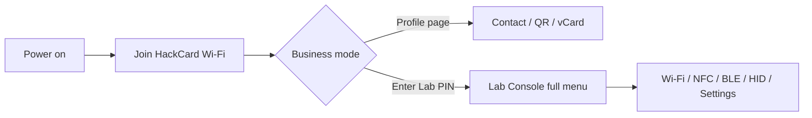

# Lab Console user guide

The **Lab Console** is the web app at **`http://192.168.4.1/`** after you connect to the HackCard Wi-Fi access point.

Source files: [`hackcard-web-ui/www/`](../hackcard-web-ui/www/) (embedded in firmware after sync).

---

## Device modes



| Mode | What you see |
|------|----------------|
| **Business** | Professional profile portal; labs hidden until PIN |
| **Lab** | Full sidebar (desktop) or bottom tabs (mobile) |

**Lab PIN** is set in firmware (`LAB_MODE_PIN` in `user_config.h`) or changed from Settings after unlock. The UI may show a sticky PIN bar on mobile — enter the same PIN to confirm sensitive actions.

---

## Connecting

1. Power HackCard via USB (recommended for labs that need stable power).
2. Connect to the AP shown in Serial boot log (default SSID often `HackCard-Setup`).
3. Open **`http://192.168.4.1/`** (not https).
4. If captive portal opens on phone, accept / use “Use network” then open the URL manually if needed.

**2.4 GHz only** — ESP32 cannot broadcast 5 GHz. See [WIFI_TROUBLESHOOTING.md](../HackCard_ESP32/docs/WIFI_TROUBLESHOOTING.md).

---

## Main areas (Lab mode)

| Area | Typical use |
|------|-------------|
| **Home / Dashboard** | Firmware version, storage tier (Flash vs Full), quick status |
| **Wi-Fi Lab** | Scan, connect STA, AP settings, captive portal, beacon / training / monitor / karma / capture |
| **NFC** | Read UID, tag info, dump, write URL/text/vCard, erase/clone/kill (Type 2), Classic tools |
| **BLE** | Scan, advertise, GATT contact card |
| **HID** | USB keyboard demos — type text, open URL, media keys (host PC required) |
| **Settings** | AP password, Lab PIN, ring/buzzer, storage preferences |
| **Terminal** | Live log from device (same family of messages as USB Serial @ 115200) |
| **Diagnostics** | Self-test style checks from the web |

Exact labels match the sidebar (desktop) or **More** tab (phone).

---

## Storage and export buttons

| Tier | Meaning |
|------|---------|
| **Flash Mode** | No SD — labs run; data on internal flash |
| **Full Mode** | SD mounted — **Export to SD** enabled for sniff logs, NFC dumps, PCAP, etc. |

Buttons marked as needing SD are disabled until a card is ready (`/api/status` reports `sd_ready`).

Details: [STORAGE.md](../HackCard_ESP32/docs/STORAGE.md).

---

## Lab PIN and safety

Many Wi-Fi and NFC actions ask for the **Lab PIN** to reduce accidental use.

- Change default PIN before demos or resale.
- Wi-Fi monitor, karma, capture, deauth demo, evil twin, training portals are for **authorized education** only.

Read: [ethics-and-authorized-use.md](ethics-and-authorized-use.md).

---

## Mobile layout

Below ~768px width the UI switches to:

- Bottom navigation (Home, Wi-Fi, NFC, More)
- Larger touch targets
- Sticky Lab PIN bar where configured

Resize a desktop browser to preview mobile layout.

---

## Editing the web UI (maintainers)

1. Edit files under `hackcard-web-ui/www/`.
2. Run sync:

```powershell
cd HackCard_ESP32\scripts
.\sync-web-ui.ps1
```

3. Rebuild and upload **`HackCard_ESP32.ino`**.

Optional: **Tools → ESP32 Sketch Data Upload** for LittleFS copy under `data/www/`.

Developer notes: [hackcard-web-ui/README.md](../hackcard-web-ui/README.md).

---

## Matching features in Arduino examples

Every major page has a Serial example — see [EXAMPLES.md](../HackCard_ESP32/library/HackCard/EXAMPLES.md) or upload **Web_Feature_Map** from **File → Examples → HackCard**.
