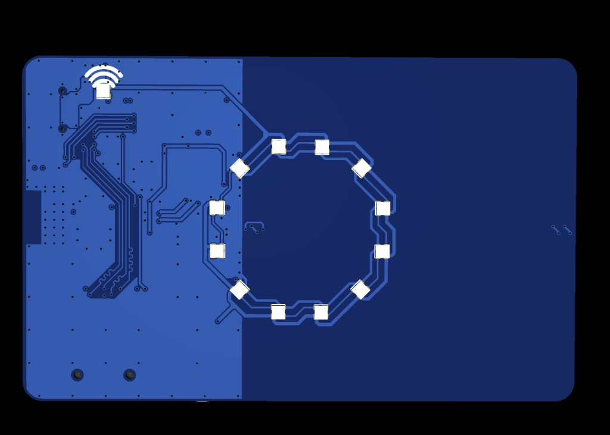

# What's on the board

On-board hardware for HackCard ESP32-S3 (from `config/board_config.h` and PCB layout).

---

## On-board components

| Component | Detail |
|-----------|--------|
| **MCU** | ESP32-S3FH4R2 — 4 MB flash, 2 MB OPI PSRAM |
| **NFC** | PN532 + PCB antenna (I2C) |
| **RGB ring** | 12× WS2812 (GPIO 45) |
| **Wi-Fi status LED** | 1× WS2812 (GPIO 38) |
| **Buzzer** | Piezo, PWM (GPIO 37) |
| **microSD** | SPI (optional — enables **Full Mode** exports) |
| **USB-C** | Power and data (flash + USB HID to host) |
| **Buttons** | **RESET** (hardware) + **BOOT** (GPIO 0, user button in firmware) |

<figure class="hardware-image" markdown="1">

<figcaption>Front — RGB ring, Wi-Fi LED area</figcaption>
</figure>

<figure class="hardware-image" markdown="1">

<figcaption>Back — NFC coil, ESP32-S3, USB-C, SD slot</figcaption>
</figure>

---

## What you supply

| Item | Required |
|------|----------|
| USB-C **data** cable | Yes — charge-only cables will not flash |
| PC with **Arduino IDE 2.x** | Yes — first firmware upload |
| microSD (FAT32) | Optional — large exports, `/wifi/exports/`, `/nfc/exports/`, etc. |
| NFC tags (NTAG, etc.) | For NFC tutorials — not included |

---

## Flash Mode vs Full Mode

| Mode | When | What changes |
|------|------|----------------|
| **Flash Mode** | No SD (or SD not mounted) | Lab Console and labs run; **Export to SD** actions stay disabled |
| **Full Mode** | FAT32 SD inserted and mounted | Export buttons enabled; Files page can browse SD |

The dashboard shows which tier is active. You do **not** copy the web UI to the SD card — it ships inside firmware.

---

## Works without a microSD

- Boot animation, ring, buzzer, Wi-Fi AP
- Lab Console at `http://192.168.4.1/`
- NFC read/write to tags (exports may stay on flash or be limited)
- USB Serial @ 115200 (boot banner shows SSID/password)
- USB HID when connected to a host PC (with correct Arduino USB mode)

---

## Next step

→ [Install tools & connect USB](first-setup.md)
