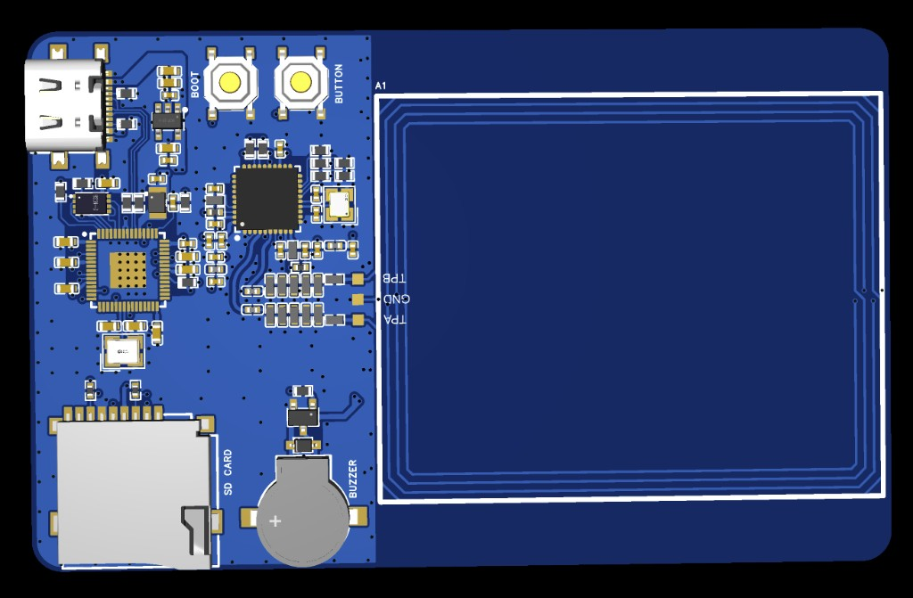
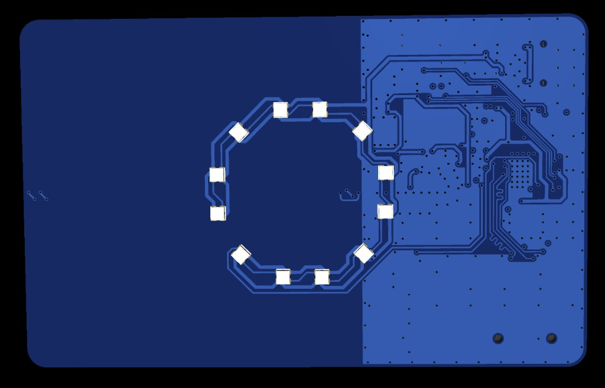

# What's on the board

HackCard RP2350 — on-board hardware (from `config/board_config.h`).

---

## On-board components

| Component | Detail |
|-----------|--------|
| **MCU** | RP2350 |
| **Flash** | 2 MB external (Arduino: **2MB (no FS)**) |
| **NFC** | PN532 + PCB antenna (I2C) |
| **RGB** | WS2812 strip (board-specific pin in `HackCard_Pins.h`) |
| **Buzzer** | Piezo |
| **microSD** | SPI (optional — lab folders, logs, Ducky scripts) |
| **USB-C** | Power, USB CDC serial, USB HID |
| **User button** | Short / long / double gestures in firmware |
| **BOOT / RUN** | Hardware only — not GPIO-tested in firmware |

<figure class="hardware-image" markdown="1">

<figcaption>Component side — USB-C, BOOT, user button, RP2350, SD slot, PCB NFC antenna</figcaption>
</figure>

<figure class="hardware-image" markdown="1">

<figcaption>LED side — WS2812 ring for status and demos</figcaption>
</figure>

---

## What you supply

| Item | Required |
|------|----------|
| USB-C **data** cable | Yes |
| PC with **Arduino IDE 2.x** | Yes |
| microSD (FAT32) | Optional — recommended for logs, dumps, `/ducky` |
| NFC tags | For NFC labs |

---

## With vs without microSD

| | **No SD** | **SD mounted** |
|---|-----------|----------------|
| Serial lab `help`, `nfc`, basic HID | Yes | Yes |
| `/logs/activity.log`, export folders | Limited | Full layout (`/hackcard`, `/nfc`, `/payloads`, `/logs`, `/ducky`) |
| Factory reset example | Clears SD lab trees | Clears SD lab trees |

Profile name and **`LAB_MODE_PIN`** live in **`user_config.h`**, not on SD.

---

## Next step

→ [Install tools & connect USB](first-setup.md)
