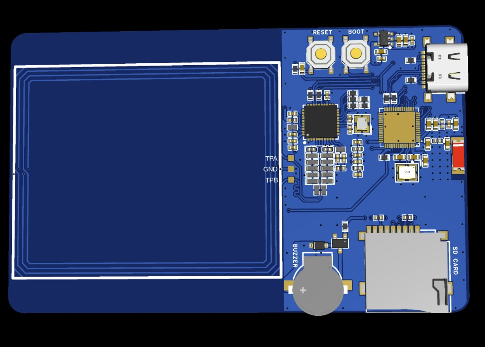

# HackCard RP2350

Credit-card sized **RP2350** lab board — NFC, USB HID, RGB, buzzer, and a **USB serial lab** at **115200** baud.

Firmware v0.1.0

[Start getting started :octicons-arrow-right-24:](getting-started/introduction.md){ .md-button .md-button--primary }

!!! tip "First session defaults"
    Serial **115200** → type **`help`**. Lab PIN in sketches/future screens: **`1234`** (change in `user_config.h`). Details: [Default PINs & serial](getting-started/default-credentials.md).

**No Wi-Fi / no web UI:** RP2350 has **no radio**. There is no `192.168.4.1` Lab Console — control the board from **Serial Monitor** and **USB HID** to your PC. For the browser dashboard, use **[HackCard ESP32](https://auratechkick.github.io/HackCard/esp32/)**.

---

## Recommended path (~30 minutes)

<ol class="backer-path" markdown="1">

<li>**[Introduction](getting-started/introduction.md)** — serial lab vs ESP32</li>
<li>**[What's on the board](getting-started/whats-included.md)**</li>
<li>**[Install tools & connect USB](getting-started/first-setup.md)**</li>
<li>**[Personalize settings](getting-started/personalize.md)**</li>
<li>**[Flash firmware](getting-started/first-program.md)**</li>
<li>**[Serial lab console](getting-started/serial-lab.md)** — `help`, NFC, HID, SD</li>
<li>**[Arduino examples](getting-started/arduino-examples.md)** — 40 sketches</li>
<li>**[Write your own sketch](getting-started/write-your-own-sketch.md)**</li>

</ol>

<figure class="hardware-image" markdown="1">

<figcaption>Front — RGB strip, user button</figcaption>
</figure>

<figure class="hardware-image" markdown="1">

<figcaption>Back — NFC coil, RP2350, USB-C, microSD</figcaption>
</figure>

---

## Verified specifications

| Spec | Value |
|------|-------|
| Board | HackCard RP2350 |
| MCU | RP2350 |
| Flash | 2 MB (W25Q16 — pick **2MB (no FS)** in Arduino) |
| Firmware | **0.1.0** |
| NFC | PN532 reader (I2C) |
| Interface | USB CDC serial + USB HID |
| Wi-Fi / BLE | **Not available** |

---

## Repository

**[github.com/auratechkick/HackCard](https://github.com/auratechkick/HackCard)** → `HackCard_RP2350/`
