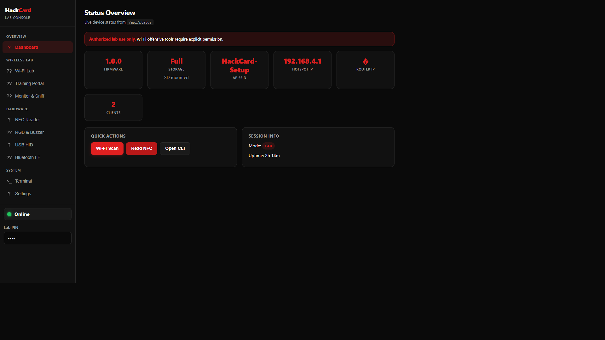
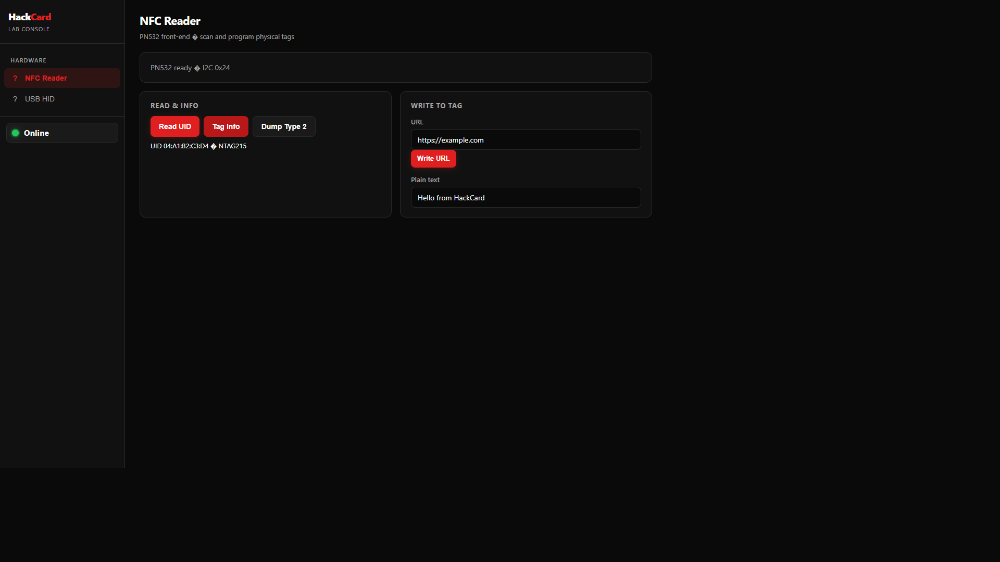
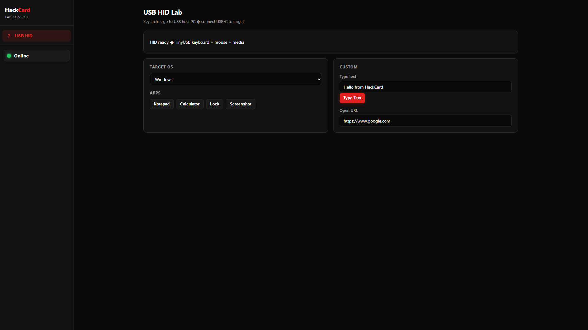
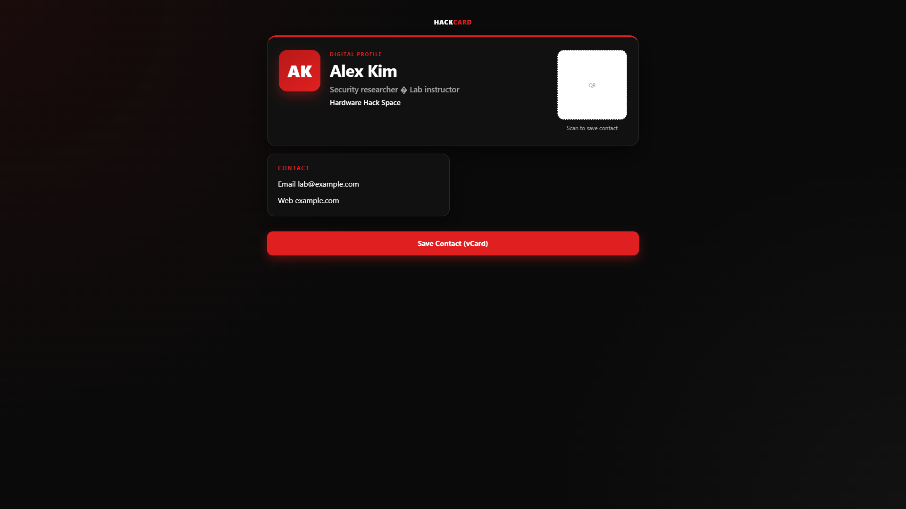
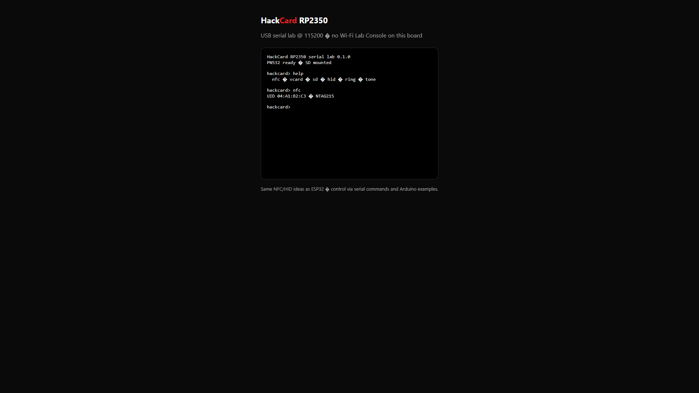

<div align="center">

# HackCard — security lab on a credit-card board

**Learn NFC, Wi-Fi, BLE, and USB HID on real hardware** — with a browser **Lab Console** (ESP32-S3) or a lean **USB serial lab** (RP2350).

[](HackCard_ESP32/LICENSE)
[](HackCard_ESP32/)
[](HackCard_RP2350/)
[](HackCard_ESP32/HackCard_ESP32/library/HackCard/EXAMPLES.md)
[](https://auratechkick.github.io/HackCard/esp32/)
[](https://auratechkick.github.io/HackCard/rp2350/)
[](HackCard_ESP32/docs/README.md)
[](https://auratechkick.github.io/HackCard/)

<br>



*Screenshots are from the embedded **Lab Console** UI. Browse more on [GitHub Pages](https://auratechkick.github.io/HackCard/) or [docs/index.html](docs/index.html).*

</div>

---

## What is this?

**HackCard** is an open firmware and Arduino library bundle for a wallet-sized **security education board**: PN532 **NFC**, **2.4 GHz Wi-Fi** labs (ESP32 only), **BLE**, **USB HID** to your PC, RGB feedback, buzzer, and optional **microSD** exports.

On **ESP32-S3**, the device runs a soft AP and serves the **Lab Console** at **`http://192.168.4.1/`** — Business mode for demos, Lab mode (PIN) for Wi-Fi monitor, karma, capture, and advanced NFC tools.

On **RP2350**, there is **no radio** and **no web UI**. You use **USB serial** (`help`, `nfc`, `hid`, …), the user button, and the same NFC/HID ideas in a smaller, USB-centric package.

> **Ethics first:** labs are for **education and authorized testing** on networks, tags, and PCs you own or have **written permission** to use. Change default AP passwords and Lab PINs before sharing a device. See [Authorized use](HackCard_ESP32/docs/ethics-and-authorized-use.md).

### Two boards, one repository

```
  HackCard_ESP32/          HackCard_RP2350/
  ESP32-S3 + Wi-Fi/BLE     RP2350 — USB serial lab
  Lab Console web UI       41 examples · production test
  73 Arduino examples
```

| | **ESP32-S3** | **RP2350** |
|---|----------------|------------|
| **Start here** | [HackCard_ESP32/README.md](HackCard_ESP32/README.md) | [HackCard_RP2350/README.md](HackCard_RP2350/README.md) |
| **Docs hub** | [docs/README.md](HackCard_ESP32/docs/README.md) | [docs/README.md](HackCard_RP2350/docs/README.md) |
| **Interface** | Browser + optional Serial | Serial **115200** only |
| **Examples** | **72** sketches | **40** sketches |
| **Wi-Fi / BLE labs** | Yes | No (not on chip) |
| **USB HID → PC** | Yes (TinyUSB) | Yes (Pico SDK USB) |

Many **desk / NFC→lock / Ducky Script** examples were built on RP2350 first; the same flows are ported on ESP32 via [`HackCardUsb.h`](HackCard_ESP32/HackCard_ESP32/library/HackCard/src/HackCardUsb.h).

---

## What HackCard is — and is not (honest)

- **Yes —** NFC read/write/dump labs, captive-portal *training* demos, BLE contact card, USB keyboard/media shortcuts, SD exports, and heavily commented **one-feature Arduino examples**.
- **Yes —** A self-contained **Lab Console** UI embedded in ESP32 firmware (no SD required for the dashboard).
- **Not —** A turnkey “hack any network” appliance. Promiscuous / deauth / karma-style sketches are **gated**, documented, and meant for **your lab**.
- **Not —** Phone NFC **card emulation** on ESP32 (PN532 is **reader/writer**).
- **Not —** RP2350 Wi-Fi or BLE; use the ESP32 tree for radio labs.

---

## Features

| | |
|---|---|
| **Lab Console** | Responsive web app: NFC, Wi-Fi, BLE, HID, Files, settings, diagnostics, serial terminal |
| **Business / Lab modes** | Public profile portal vs PIN-gated security labs |
| **NFC (PN532)** | UID, NDEF, Type 2 dump/clone/erase/kill, MIFARE Classic labs (ESP32) |
| **Wi-Fi lab** | Scan, AP, STA, captive portal, beacon, training portal, monitor, karma, EAPOL capture |
| **BLE** | Scan, advertise, GATT contact card |
| **USB HID** | Type text, OS shortcuts, media keys, mouse, Ducky Script (library helpers) |
| **Storage** | Flash-only mode or Full mode with FAT32 microSD. Files page reads the card in the slot. Factory-reset examples clear saved settings |
| **114 examples** | 73 ESP32 + 41 RP2350 — each maps to a lab feature or real-life demo |

---

## Gallery — Lab Console & RP2350

| Dashboard | NFC Reader | USB HID |
|:---:|:---:|:---:|
|  |  |  |

| Business profile | RP2350 serial lab |
|:---:|:---:|
|  |  |

Console tour: [Lab Console user guide](HackCard_ESP32/docs/lab-console-user-guide.md) · Regenerate captures: [docs/README.md](docs/README.md).

---

## Quick start

### ESP32-S3 — full product (Lab Console)

1. Install **Arduino IDE 2.x** + **esp32** board support → [Arduino setup](HackCard_ESP32/HackCard_ESP32/docs/ARDUINO_SETUP.md).
2. Edit [`user_config.h`](HackCard_ESP32/HackCard_ESP32/config/user_config.h) (name, AP password, **Lab PIN**).
3. Open [`HackCard_ESP32.ino`](HackCard_ESP32/HackCard_ESP32/HackCard_ESP32.ino) → board **ESP32S3 Dev Module**, **USB CDC On Boot**, **USB-OTG (TinyUSB)** → upload.
4. Join the HackCard Wi-Fi (Serial **115200** prints SSID/password) → open **`http://192.168.4.1/`**.

First-time walkthrough: [Getting started](HackCard_ESP32/docs/getting-started.md) · Console tour: [Lab Console user guide](HackCard_ESP32/docs/lab-console-user-guide.md).

### ESP32 — one Arduino example (no web UI)

1. Copy or install [`library/HackCard`](HackCard_ESP32/HackCard_ESP32/library/HackCard) → **File → Examples → HackCard**.
2. Start with `01_Basics/Hello_RGB_Ring` or `00_Start_Here/Web_Feature_Map`.
3. Full index: [EXAMPLES.md](HackCard_ESP32/HackCard_ESP32/library/HackCard/EXAMPLES.md).

### RP2350 — serial lab

1. Install **arduino-pico** (Philhower) → [Getting started](HackCard_RP2350/docs/getting-started.md).
2. Run [`scripts/install-library.ps1`](HackCard_RP2350/scripts/install-library.ps1).
3. Open [`HackCard_RP2350.ino`](HackCard_RP2350/HackCard_RP2350/HackCard_RP2350.ino) → **Generic RP2350**, **2MB (no FS)**, **USB Stack: Pico SDK** → upload → Serial **115200** → `help`.

---

## How it works (architecture)

**ESP32 — high level**

```
Phone/PC ── Wi-Fi ──► ESP32-S3 (soft AP or STA)
                         ├── Lab Console (embedded web UI)
                         ├── REST API + WebSocket terminal
                         └── Apps: NFC / Wi-Fi / BLE / HID / storage
```

Details: [architecture.md](HackCard_ESP32/docs/architecture.md).

**RP2350 — high level**

```
PC ◄── USB CDC (115200, help/nfc/hid) ──► RP2350
PC ◄── USB HID (keyboard/mouse) ────────►  same cable
         PN532 · RGB · buzzer · optional SD
```

Details: [RP2350 architecture](HackCard_RP2350/docs/architecture.md).

---

## Project structure

```
HackCard/
├── README.md                 ← you are here
├── docs/                     ← GitHub Pages (gallery + MkDocs builds)
│   ├── index.html            ← landing + links to both guides
│   ├── esp32/                ← built ESP32 MkDocs user guide
│   ├── rp2350/               ← built RP2350 MkDocs user guide
│   └── assets/*.png          ← README / gallery screenshots
├── HackCard_ESP32/           ← firmware 1.0.2, Lab Console, 73 examples
│   ├── user-guide/           ← ESP32 MkDocs source → docs/esp32/
│   ├── HackCard_ESP32/       ← main sketch + src/apps/
│   └── docs/                 ← in-repo markdown references
└── HackCard_RP2350/          ← firmware 0.1.0, 40 examples, QC sketch
    ├── user-guide/           ← RP2350 MkDocs source → docs/rp2350/
    ├── HackCard_RP2350/      ← serial lab firmware
    └── docs/
```

---

## Documentation map

| Audience | Link |
|----------|------|
| New ESP32 owner | [ESP32 user guide (MkDocs)](https://auratechkick.github.io/HackCard/esp32/) · [getting-started.md](HackCard_ESP32/docs/getting-started.md) |
| New RP2350 owner | [RP2350 user guide (MkDocs)](https://auratechkick.github.io/HackCard/rp2350/) · [getting-started.md](HackCard_RP2350/docs/getting-started.md) |
| Lab Console only | [User guide](HackCard_ESP32/docs/lab-console-user-guide.md) |
| Custom sketches (ESP32) | [Custom development](HackCard_ESP32/HackCard_ESP32/docs/CUSTOM_DEVELOPMENT.md) |
| Custom sketches (RP2350) | [Custom development](HackCard_RP2350/docs/CUSTOM_DEVELOPMENT.md) |
| REST / automation | [API overview](HackCard_ESP32/docs/api-overview.md) |
| Changelog | [ESP32 CHANGELOG](HackCard_ESP32/HackCard_ESP32/CHANGELOG.md) · [RP2350 CHANGELOG](HackCard_RP2350/HackCard_RP2350/CHANGELOG.md) |

---

## License

MIT — see [HackCard_ESP32/LICENSE](HackCard_ESP32/LICENSE) (same terms for both product trees).

---

<div align="center">

### **HackCard** · open security-lab firmware for makers and classrooms

[](HackCard_ESP32/docs/README.md)
[](HackCard_ESP32/HackCard_ESP32/library/HackCard/EXAMPLES.md)
[](HackCard_RP2350/library/HackCard_RP2350/EXAMPLES.md)

</div>
